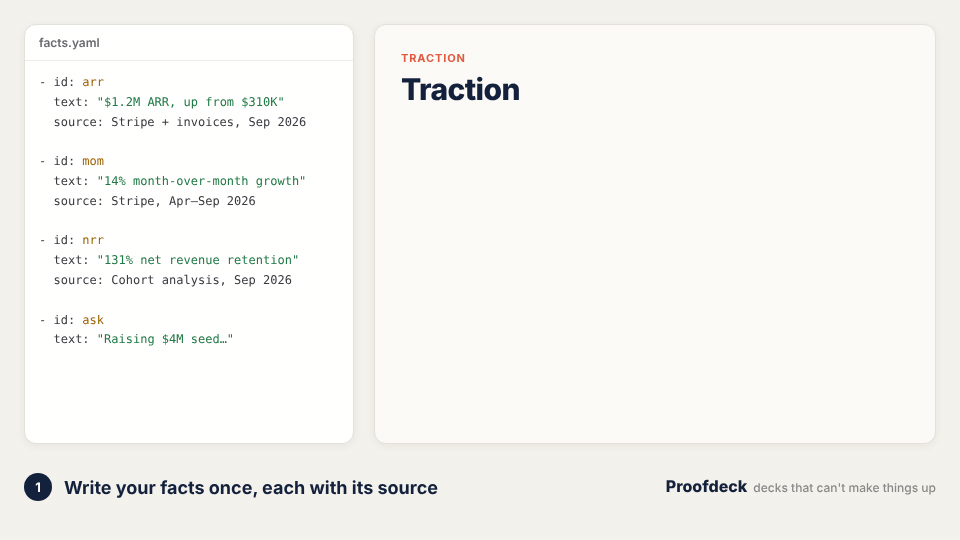
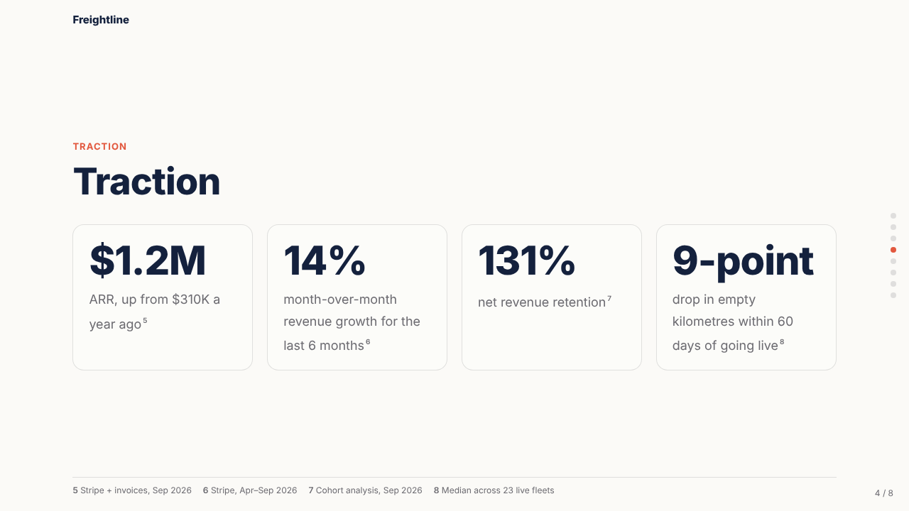
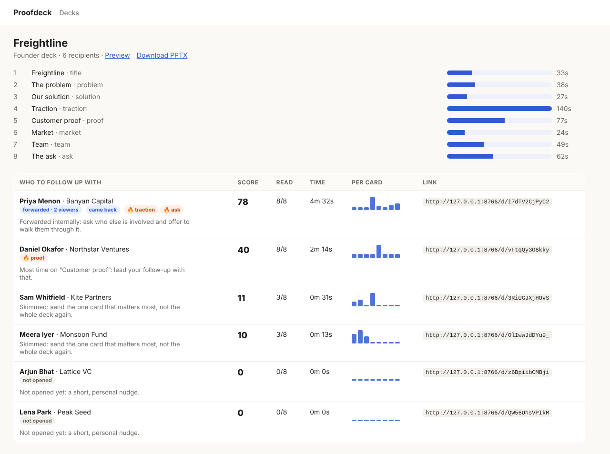

<div align="center">

# Proofdeck

**AI decks for founders and sales that can't make things up, and tell you who actually read them.**

Write your facts once. Proofdeck turns them into a fundraising deck or a deal-specific sales deck,<br>
cites a source for every number, then gives each investor or stakeholder their own tracked link.

[](https://github.com/keshava3112/Proofdeck/actions/workflows/ci.yml)
[](LICENSE)




</div>

---

AI deck tools are great at making slides *look* good. For a founder or a sales rep,
that was never the hard part. The hard parts are:

1. **Saying things that are true and specific.** A hallucinated ARR figure in a
   pitch deck, or a made-up discount in a proposal, is worse than no deck at all.
2. **Knowing what happened after you hit send.** Who opened it? Who skimmed?
   Who sat on the pricing slide for three minutes, then forwarded it to their CFO?

Proofdeck does both, and it's open source and self-hosted, so your numbers and
your investor list stay on your own machine.

## Try it in 30 seconds

No API key needed. The demo runs the whole loop on a fictional startup:

```bash
git clone https://github.com/keshava3112/Proofdeck && cd Proofdeck
pip install -e ".[dev]"
proofdeck demo
```

It builds the deck (`out/deck.html` and `out/deck.pptx`), shows the gate rejecting
an invented number, shares the deck with six investors, simulates a week of reading,
and prints who to follow up with. Then run
`proofdeck serve --db sqlite:///out/demo.db` and open
`http://localhost:8000/admin?key=demo` to see the dashboard.

## How it works

### 1. Facts, not prompts

Everything a deck may say lives in `facts.yaml`, with a source for each fact:

```yaml
company: Freightline
facts:
  - id: arr
    kind: metric
    text: "$1.2M ARR, up from $310K a year ago"
    source: Stripe + invoices, Sep 2026
  - id: cs2
    kind: case_study
    text: Sahyadri Cold Chain added ₹40L a month in backhaul revenue
    source: Customer finance team, Aug 2026
    tags: [cold-chain, food]
```

For sales, add what you learned on the discovery call. The prospect's own words
become citable facts:

```yaml
mode: sales
recipient: {name: Meera Nair, company: Juniper Foods, role: COO, industry: food}
quotes:
  - {speaker: Meera, text: "Every order comes in on WhatsApp and someone re-types it into Excel."}
goal: Start the free pilot on Juniper's Hosur route.
```

### 2. The grounding gate

The model writes **typed cards** (problem, traction, proof, pricing, plan, ask…)
made of bullets, and each bullet lists the facts it relies on. Then a validator checks
every number:

```
✗ card 3 bullet 4: [G2] numbers ['2m'] are not in its cited facts ['arr']
```

If a number isn't in a fact that bullet cites, the model gets one chance to fix it.
If it still doesn't, the line is dropped. Formats like `$1.2M` and `1.2 m`, or
`1,200` and `1200`, are normalised before comparison; small counts and years are exempt. The
rules are in [`proofdeck/validate.py`](proofdeck/validate.py), each with a test.

### 3. A deck that looks the part, in both formats

<p align="center"></p>

- **Web:** responsive, keyboard navigable and print-friendly, with a source line on every card.
- **PPTX:** exact. Each card type maps to one slide layout, so nothing gets
  approximated, and sources go in the slide footer.
- **Brand:** colours, font and logo come from `brand.yaml`.

### 4. One tracked link per person

```bash
proofdeck share out/deck.json facts.yaml investors.csv --base-url https://decks.yourco.com
```

Every recipient gets their own link. The viewer reports **time per card** (only
while the tab is visible), and Proofdeck turns that into signals:

| Signal | How it's detected |
|---|---|
| 👀 Opened | First visit on the link |
| 🔥 Lingered | 45s+ on a pricing, traction, ask, proof or plan card |
| ↗️ Forwarded | A new device on a different network opens the same link. Clearing cookies on the same network doesn't count. |
| 🔁 Came back | A new session 12h+ after the last one |

Alerts go to Slack (set `SLACK_WEBHOOK_URL`) or the console. Add `--gate` to
ask for an email before the deck is shown.

### 5. Who to follow up with

<p align="center"></p>

The dashboard ranks recipients by an explainable engagement score: how much they
read, forwards, return visits and hot cards. Each row comes with a concrete
suggestion, like *"Most time on Customer proof: lead your follow-up with that."*

## Using Claude to write the deck

```bash
export ANTHROPIC_API_KEY=sk-ant-...
proofdeck build proofdeck/examples/sales/facts.yaml proofdeck/examples/sales/call.yaml \
  --brand proofdeck/examples/brand.yaml
```

With a key set, `build` uses Claude with a strict tool schema and the repair loop
described above. Set the model with `PROOFDECK_MODEL`. Without a key, a
deterministic template generator lays your facts into the canonical card order,
which is handy for CI and for testing your facts file.

## Self-hosting

```bash
docker build -t proofdeck . && docker run -p 8000:8000 \
  -e PROOFDECK_ADMIN_KEY=change-me -v $PWD/data:/data proofdeck
```

It uses SQLite by default; set `DATABASE_URL` for Postgres (`pip install -e ".[postgres]"`).
Put it behind your own domain, since recipients see that URL.

## Roadmap

- [ ] Live metrics: pull traction numbers from Stripe or a sheet at view time, still cited
- [ ] CRM sync: write views and signals to HubSpot or Salesforce timelines
- [ ] Transcript import: Gong, Fireflies or a raw `.vtt` → quotes, pains and a goal
- [ ] An outcome loop: learn which cards predict a reply or a stage change
- [ ] Monthly investor update generated from the same facts
- [ ] More card types and layouts (comparison, timeline, team grid)
- [ ] An in-browser facts editor

Contributions are welcome. See [CONTRIBUTING.md](CONTRIBUTING.md).

## Project layout

```
proofdeck/
  facts.py        facts library + number normalisation
  schema.py       typed cards, decks
  validate.py     the grounding gate (G1–G5) and sanitizer
  generate.py     template generator, Claude generator with repair loop
  render.py       HTML viewer (templates/deck.html), brand tokens
  export_pptx.py  exact PPTX export
  tracking.py     beacons → visits, forwards, returns, hot cards, scores (T1–T6)
  server.py       viewer, beacon endpoint, email gate, dashboard
  cli.py          demo, build, share, serve, report
  examples/       a founder and a sales scenario for a fictional company
scripts/          make_demo_gif.py renders the README animation
```

## Privacy

Tracking is first-party and per link: a random cookie, the browser family, and a
truncated /24 network hash for forward detection. No third-party scripts and no
fingerprinting beyond that. Tell recipients you use view analytics where your
jurisdiction requires it.

## License

[MIT](LICENSE). If Proofdeck helped you close a round or a deal, a ⭐ helps others find it.
